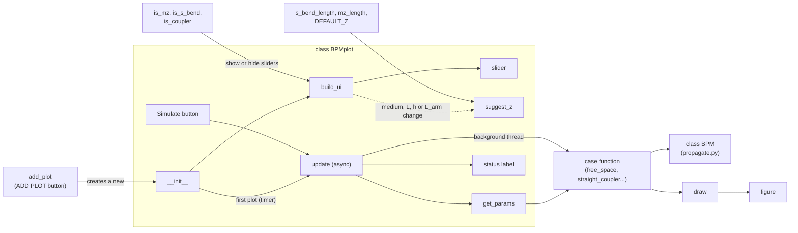

# Class BPMplot
## Graphical interface (NiceGUI) for the BPM simulations
This class builds an input panel (sliders for the beam and the guide parameters, medium selector, injection options) and an output panel with the intensity map $|A(x,z)|^2$ and a status line. The calculation is delegated to the functions of each case (free space, single waveguide, straight coupler, S-bent coupler, Mach-Zehnder), which use the BPM class. 

## Draw
Before building the class, we define the draw function, which plots the intensity map $|A(x,z)|^2$ from the results of a simulation and which will be used later inside the class.
::: interfaccia.draw
    options:
        show_root_heading: true
        show_root_full_path: false

## Class BPMplot
The class BPMplot only handles the interface: it reads the controls, runs the simulation and displays the result, using the classes listed below.
::: interfaccia.BPMplot

# Extra functions
::: interfaccia.add_plot
    options:
        show_root_heading: true
        show_root_full_path: false
::: interfaccia.remove_all
    options:
            show_root_heading: true
            show_root_full_path: false