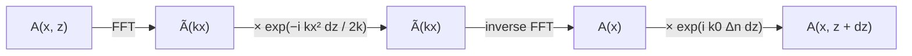

# Physics

## 1. Paraxial wave equation

We study a monochromatic beam that propagates along $z$ in a medium with refractive index
$n(x) = n_0 + \Delta n(x, z)$. We write the field as $E = A(x, z)\, e^{i(kz - \omega t)}$, where
$A$ is an envelope that changes slowly along $z$. It follows the paraxial wave equation:

$$
\frac{\partial A}{\partial z} = \frac{i}{2k}\frac{\partial^2 A}{\partial x^2} + i k_0\,\Delta n(x, z)\,A,
\qquad k_0 = \frac{2\pi}{\lambda_0}, \quad k = k_0 n_0
$$

- The first term is the **diffraction**: it makes the beam wider.
- The second term is the effect of the **refractive index**: where $\Delta n > 0$ the phase goes
  faster, so the light is focused. This is what guides the light in a waveguide.

## 2. Split-step Fourier method

The two terms are easy to solve separately:

- the diffraction is simple in **Fourier space**, because $\partial^2/\partial x^2 \to -k_x^2$
- the index term is simple in **real space**

So at each step $dz$ we apply them one after the other:

$$
\tilde A \leftarrow \tilde A\, e^{-i k_x^2\, dz / 2k}
\qquad \text{then} \qquad
A \leftarrow A\, e^{i k_0 \Delta n(x, z)\, dz}
$$

All the structures use the same code: only the profile $\Delta n(x, z)$ changes. For the S-bends
and the Mach-Zehnder, $\Delta n$ depends on $z$, so it is computed again at each step.

### Numerical parameters

| Parameter | Value | Why |
|---|---|---|
| window in $x$ | 400 µm | the light never reaches the edges |
| number of points | 4000 ($dx = 0.1$ µm) | much smaller than the guides (4 µm) |
| step $dz$ | 1 µm | $k_0\, \Delta n_{max}\, dz \approx 0.04 \ll 1$ |
| wavelength $\lambda_0$ | 1.55 µm | telecom wavelength |

The FFT makes the window periodic: light leaving on one side comes back on the other side. With
a window of 400 µm this does not happen in our simulations.

## 3. Diffraction in free space

In free space ($\Delta n = 0$) the input Gaussian beam $A(x, 0) = \exp(-x^2/w_0^2)$ stays Gaussian,
but it becomes wider:

$$
w(z) = w_0\sqrt{1 + \left(\frac{z}{z_R}\right)^2}, \qquad z_R = \frac{\pi n_0 w_0^2}{\lambda_0}
$$

$z_R$ is the Rayleigh length. A small waist diffracts faster.

## 4. Waveguides

### Index profile

The guides have a **super-Gaussian** profile of width $W$ and order $p$:

$$
\Delta n(x) = \Delta n_{max} \exp\left[-\left(\frac{2|x - x_c|}{W}\right)^{2p}\right]
$$

For $p = 1$ it is a Gaussian. When $p$ increases, it becomes close to a step index, but it stays
smooth, which is better for the FFT. We use $p = 4$.

### Modes

A guide has **modes**: field profiles that keep the same shape during the propagation. Their
number depends on the width $W$ and on $\Delta n_{max}$:

- a narrow guide with a small $\Delta n$ has only one mode (**single mode**)
- a wide guide with a large $\Delta n$ has several modes (**multimode**)

When several modes are excited, they propagate at different speeds and interfere. This gives
the periodic patterns of the multimode guide.

## 5. Coupling between two guides

When two identical guides are close, the evanescent field of one guide reaches the other one.
The two guides together have two modes, called **supermodes**:

- the **even** supermode, where the field has the same sign in the two guides
- the **odd** supermode, where the field has opposite signs

The two supermodes have different propagation constants $\beta_{even}$ and $\beta_{odd}$.
Light injected in guide 1 is the sum of the two supermodes. Along $z$ they get out of phase,
and the light moves to guide 2, then comes back:

$$
P_2(z) = \sin^2\left(\frac{\pi z}{2 L_c}\right), \qquad L_c = \frac{\pi}{\beta_{even} - \beta_{odd}}
$$

$L_c$ is the **coupling length**, the distance for a full transfer. When the gap increases,
the supermodes become closer, so $L_c$ increases very fast.

If the light is injected in the two guides with the same phase, only the even supermode is
excited, and there is no exchange of power.

## 6. S-bent coupler

In the S-bent coupler the distance between the guides changes along $z$. Each guide makes an
S-bend made of two arcs of radius $R = 75$ mm with opposite curvature.

- At the input and the output the guides are far apart: they are **uncoupled**.
- In the straight part of length $L_0$ they are at a distance $d = W + \text{gap}$: they are **coupled**.
- The length of one S-bend is $L_s = \sqrt{4Rh - h^2}$.

The coupling also happens in the S-bends, where the guides are already close. So the power at the
output depends on $L_0$ and also on the shape of the S-bends ($h$, $R$).

## 7. Mach-Zehnder interferometer

The Mach-Zehnder is made of two 50/50 couplers and two arms. On one arm we add a small index
$\delta n$ over a length $L_{arm}$. The light in this arm gets an extra phase:

$$
\Delta\varphi = \Gamma\, k_0\, \delta n\, L_{arm}
$$

$\Gamma$ is the **confinement factor**: the part of the mode that is inside the guide. Only this
part sees $\delta n$. After the second coupler, the power in each output depends on $\Delta\varphi$:

$$
P_{bottom} = \sin^2\left(\frac{\Delta\varphi}{2}\right), \qquad P_{top} = \cos^2\left(\frac{\Delta\varphi}{2}\right)
$$

### Optical path difference

The phase shifter makes the optical path of one arm longer. The **optical path difference**
between the two arms is

$$
\Delta = \Gamma\, \delta n\, L_{arm}, \qquad \Delta\varphi = \frac{2\pi}{\lambda_0}\,\Delta
$$

When the two arms are recombined in the second coupler, they **interfere**. The output depends
on $\Delta$ compared with the wavelength:

| Path difference $\Delta$ | Phase $\Delta\varphi$ | Output |
|---|---|---|
| 0 | 0 | all the light in the **top** guide |
| $\lambda_0/4$ | $\pi/2$ | 50 % / 50 % |
| $\lambda_0/2$ | $\pi$ | all the light in the **bottom** guide |
| $\lambda_0$ | $2\pi$ | back to the **top** guide |

The output is **periodic**: each time $\Delta$ increases by one wavelength, we come back to the
same state.

**In our simulation.** The full switch is obtained for $\delta n = 5.04 \times 10^{-4}$ with
$L_{arm} = 2000$ µm and $\Gamma = 0.769$:

$$
\Delta = 0.769 \times 5.04 \times 10^{-4} \times 2000\ \mu m \approx 0.775\ \mu m = \frac{\lambda_0}{2}
$$

This is exactly the condition for destructive interference in the top output.

**Applications.**

- A very small index change (here 0.05 % of the index) moves all the light from one output to
  the other. This is the principle of **electro-optic modulators** and **optical switches**,
  where $\delta n$ is controlled by a voltage.
- For the same $\Delta$, the phase $\Delta\varphi = 2\pi\Delta/\lambda_0$ depends on the
  wavelength. So a Mach-Zehnder can also be used as a **wavelength filter**: some wavelengths go
  to one output and the others to the other output.
